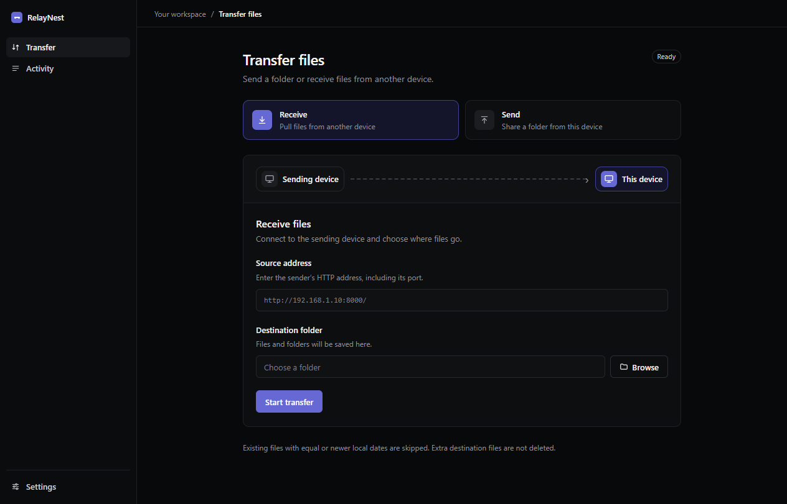
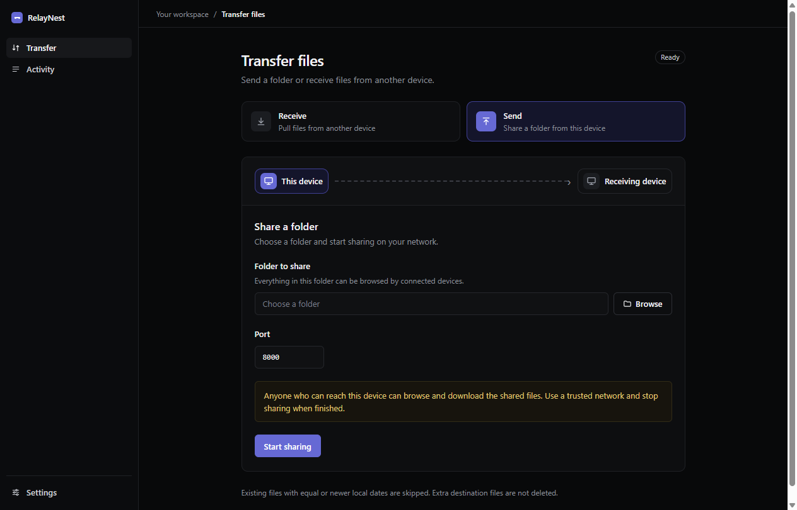
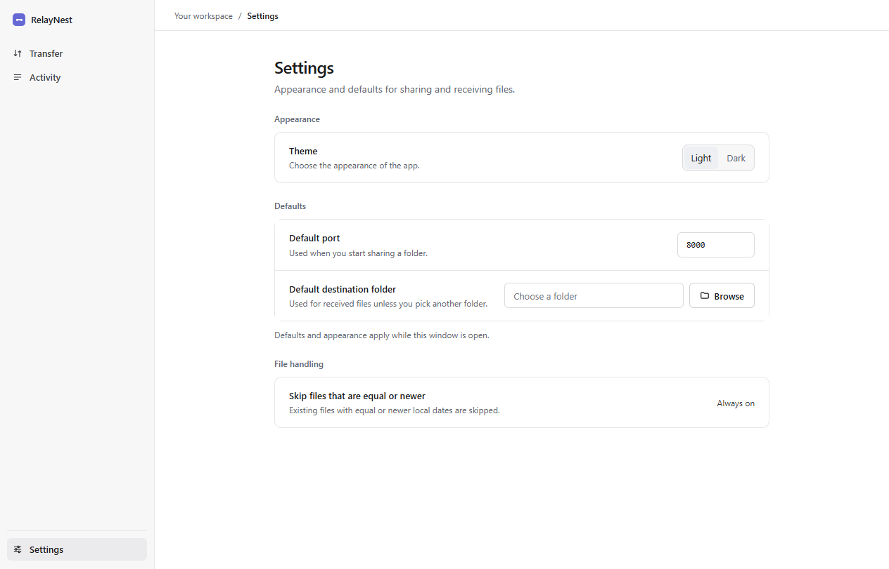

# RelayNest

RelayNest is a desktop app for copying folders between computers on a trusted network. Choose **Send** on the computer with the files and **Receive** on the other computer. The receiver recreates folders, downloads files in parallel, and checks existing files before downloading them again.

RelayNest is a development build. The Windows executable can be built, but its packaged app tests and a transfer between two different machines have not yet been verified. On the development laptop, Windows Defender blocked the executable from running. See [Windows build, signing and installation](WINDOWS_INSTALL.md) before sharing a build.

## Screenshots

These screenshots show the source-based desktop app in its ready state.

**Receive files**



**Share a folder**



**Light mode settings**



## Run the desktop app from source

On Windows, install Python 3.13 and Node.js. From the RelayNest project folder in PowerShell:

```powershell
npm install
npm start
```

`npm install` creates a project `.venv` if needed and installs the Python desktop requirements, including `requirements.txt`. Python must be installed and available on your PATH. `npm start` uses the project `.venv` when available. Alternatively, after setup, start the app without Node.js:

```powershell
.\.venv\Scripts\python.exe desktop_host.py
```

The Windows desktop interface uses the WebView2 Runtime. The project also targets macOS and Linux through pywebview, but those platforms and their setup have not been verified. For development setup, tests, and a one-machine walkthrough, see [DEVELOPMENT.md](DEVELOPMENT.md).

## Transfer between two computers

1. Start RelayNest on both computers. Use a trusted network and test with non-sensitive files first.
2. On the computer **with the files**, choose **Send**, select the source folder, set the port if needed, and choose **Start sharing**. Keep the window open.
3. Copy the displayed share address and give it to the receiver. If several network addresses are available, select the one for the network both computers use. If no address is shown, use `ipconfig` to find the sender's IPv4 address and combine it with the selected port, for example `http://192.168.1.10:8000/`. A firewall may need an approved rule.
4. On the receiving computer, choose **Receive**. Enter the sender's share address, choose a destination folder and select **Start transfer**.
5. Open **Activity** to review the log and summary. Check the destination files, then stop sharing on the sender.

The receive summary shows data downloaded during the current run and elapsed time, including scanning and retries. Skipped files and data resumed from an earlier run do not count toward the transferred data; retries can add to it.

When both devices use a RelayNest version that supports transfer status, the sender also sees a live receiver timer and the final duration. If status updates stop arriving, the sender reports that the receiver status is unavailable. Status messages, like file sharing, are unauthenticated and intended for trusted networks.

The device flow highlights activity while a client is accessing the shared folder and shows the last request afterward. This indicates HTTP activity, not a persistent or authenticated device pairing.

A single app window handles one active send or receive session at a time. For a one-computer test, use two app windows, two different folders, and `http://127.0.0.1:8000/` as described in [DEVELOPMENT.md](DEVELOPMENT.md).

## What happens on a repeat transfer

The receiver checks the sender's metadata on every run. When a destination file already exists:

- A source with a newer modification date replaces it after the download finishes.
- A file with an equal or newer local modification date is skipped.
- If the sender doesn't provide a valid `Last-Modified` date, the existing file is left untouched and the transfer reports a failure.

Downloaded files retain the source modification date. HTTP dates have one-second precision, and timestamps do not prove that contents match. Clock differences or changes within one second can therefore lead to a skip; RelayNest does not verify file hashes. Extra destination files are not deleted.

Keep the destination's `.transfer-state` folder between runs. It stores partial downloads, a record of completed downloads, and a failure log. Partial downloads can resume when the sender supplies suitable metadata and supports range requests; otherwise they restart. Avoid running multiple receivers against the same destination at the same time.

The receiver excludes dependency folders, common caches and virtual environments, plus certain generated files. The lists are defined in [receive.py](receive.py). `.git` contents are included; copying a worktree or submodule may not preserve references outside the shared folder.

## Activity and settings

**Activity** shows the current session's output, status, and errors. **Settings** offers light and dark themes, a default port, and a default destination. These settings and activity are kept only while the app window is open. The existing-file skip policy is always on.

## Security and current limits

- The sharing server is unauthenticated and uses unencrypted HTTP. Anyone who can reach it can browse and download the shared folder. Share only intended files on a trusted network and stop the server afterward.
- The receiver's path and symlink handling needs further hardening for untrusted sources. Source files should remain unchanged during a transfer.
- Pairing, encrypted transport, persistent history, automatic updates, per-file retry, and measured overall progress are not implemented.
- The executable is an unsigned development build, not a verified release. Runtime behavior and transfer between different operating systems still require testing.

## Build and test

On 64-bit Windows, `npm run build` creates `dist\RelayNest.exe`. `npm run test:engine` tests the source engine; `npm run test:package` and `npm run test:packaged-ui` test the executable and its window. The packaged tests have been blocked by Windows security on the development laptop. See [WINDOWS_INSTALL.md](WINDOWS_INSTALL.md) for build prerequisites, signing, troubleshooting and release checks.

RelayNest also retains the original `server.py` and `receive.py` command-line scripts. They use settings near the top of each file; confirm those settings before using them. The desktop app does not require editing those constants.
